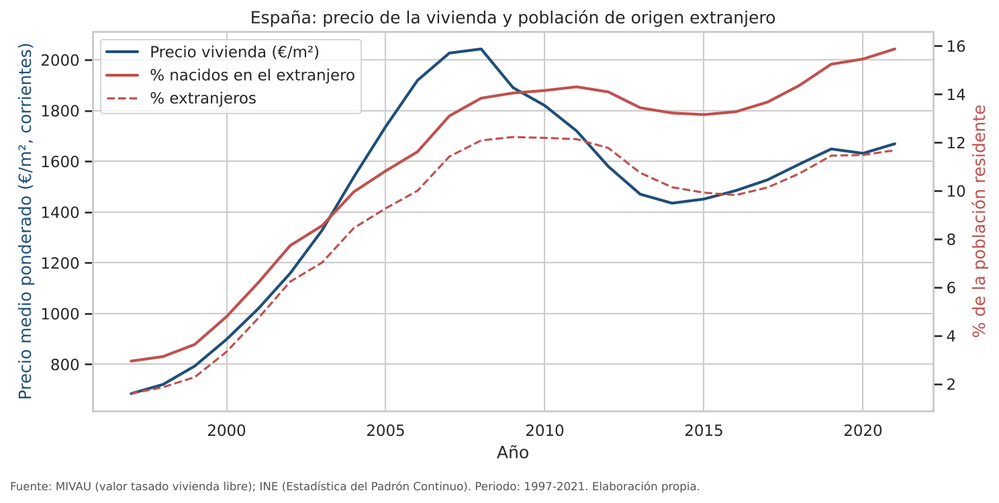
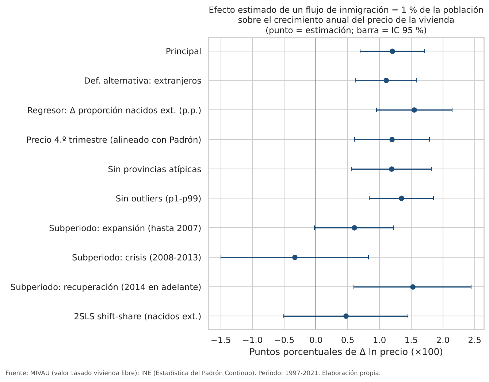

# El impacto de la inmigración en los precios de la vivienda en España
### Un análisis econométrico territorial y temporal (panel provincial)


> **Estado del proyecto:** estimado con datos oficiales del INE (Padrón, tablas 03005 y 03006) y del MIVAU (valor tasado, VDP006_01) para **52 provincias, 1997-2021**. **Aún sin controles económicos** (PIB, paro, edad y densidad de Eurostat): el código los descarga, pero esta ejecución se hizo sin ellos. Los resultados de abajo deben leerse con esa limitación.
---

## Resumen ejecutivo

Entre comienzos de los años 2000 y la actualidad, España ha vivido dos grandes oleadas de inmigración y dos ciclos de fuerte subida del precio de la vivienda. La coincidencia temporal no demuestra una relación causal. Los inmigrantes eligen dónde instalarse, y suelen hacerlo donde hay empleo, que es también donde sube la demanda de vivienda por otros motivos.

Este proyecto construye un **panel de las 52 provincias españolas** con datos oficiales (INE, MIVAU y Eurostat) y estima la relación entre el crecimiento de la población nacida en el extranjero y el crecimiento del precio de la vivienda. Avanza en varios pasos:

1. **Análisis descriptivo** de la evolución y la distribución territorial de ambas variables.
2. **MCO agrupado** con controles económicos y demográficos.
3. **Panel con efectos fijos** de provincia y año, errores agrupados por provincia, retardos distribuidos y contrastes de significatividad conjunta.
4. **Variables instrumentales** *shift-share* (Card, 2001; González y Ortega, 2013) basadas en la distribución histórica de cada nacionalidad entre provincias, con una discusión explícita de sus supuestos y riesgos.
5. **Robustez**: definiciones alternativas, exclusión de provincias atípicas y de valores extremos, subperiodos del ciclo, *leave-one-province-out*, multicolinealidad y autocorrelación.

El objetivo es medir la magnitud de la relación y hasta dónde puede interpretarse como causal, sin partir de una conclusión predeterminada.

## Pregunta de investigación

> ¿En qué medida el crecimiento de la población nacida en el extranjero en una provincia se asocia con el crecimiento del precio de la vivienda, y puede esa relación interpretarse como un efecto causal?

## Hipótesis

| | Hipótesis |
|---|---|
| **H1** | Un flujo neto de población nacida en el extranjero equivalente al 1 % de la población provincial se asocia con un mayor crecimiento anual del precio (β > 0), condicionado a efectos fijos y controles. |
| **H2** | El efecto acumulado a dos años supera al contemporáneo (ajuste lento de la oferta). |
| **H3** | El efecto se atenúa con más construcción y puede compensarse por salidas de población nativa. |
| **H4** | MCO/EF no identifican el efecto causal por la elección endógena del destino. El signo del sesgo es ambiguo. |

Detalle teórico, mecanismos y efectos contrapuestos: [`docs/methodology.md`](docs/methodology.md).

## Datos

| Concepto | Variable | Fuente | Escala |
|---|---|---|---|
| Precio de la vivienda | Valor tasado vivienda libre (€/m²) | MIVAU | Provincia, trimestral |
| Población nacida en el extranjero | Stock a 1 de enero | INE, Padrón Continuo | Provincia |
| Población extranjera (por nacionalidad) | Stock a 1 de enero | INE, Padrón Continuo | Provincia |
| PIB, población, estructura por edades, superficie | | Eurostat | NUTS-3 → provincia |
| Tasa de paro | | Eurostat (EPA) | CCAA |
| Tipo de interés a 10 años | | Eurostat | España |
| Viviendas terminadas | | MIVAU | Provincia |

Se distingue explícitamente entre **población nacida en el extranjero**, **población extranjera** (nacionalidad) y **flujos netos**: ver [`docs/methodology.md` §4](docs/methodology.md#4-definiciones-no-son-categorías-equivalentes). Las fuentes, las rutas de descarga y los datos no disponibles están en [`docs/data_sources.md`](docs/data_sources.md).

## Metodología

**Modelo principal (panel con efectos fijos):**

$$100\,\Delta\ln P_{pt} = \beta \cdot \underbrace{100\,\frac{FB_{pt}-FB_{p,t-1}}{Pob_{p,t-1}}}_{\text{flujo neto de nacidos en el extranjero}} + X_{pt}'\gamma + \mu_p + \tau_t + \varepsilon_{pt}$$

- β: puntos porcentuales de crecimiento anual del precio asociados a un flujo neto igual al 1 % de la población.
- μ<sub>p</sub>, τ<sub>t</sub>: efectos fijos de provincia y de año. τ<sub>t</sub> absorbe tipos de interés, crédito y ciclo nacional.
- Errores estándar agrupados por provincia.

**Identificación causal (2SLS):** el instrumento es el flujo predicho

$$Z_{pt} = 100 \sum_n s_{n,p,t_0}\,\frac{\Delta N^{(-p)}_{n,t}}{Pob_{p,t-1}}$$

que combina el peso inicial de cada nacionalidad en la provincia con su crecimiento nacional sin contar esa provincia (*leave-one-out*). Su validez exige que la geografía inicial de los enclaves no prediga *shocks* posteriores de precios por otras vías. Ese supuesto no puede contrastarse directamente y se discute en detalle en la metodología.

## Resultados

> Todas las cifras proceden de `results/` y se generan automáticamente con `python -m src.run_pipeline`. Muestra: 52 provincias, 1997-2021 (1.216 observaciones provincia-año en el modelo principal). Errores agrupados por provincia. **Sin controles económicos.**



### Resultados principales

| Especificación | β | IC 95 % | p |
|---|---|---|---|
| MCO agrupado (sin efectos fijos) | 5,49 | — | <0,001 |
| **EF provincia + año (principal)** | **1,20** | 0,69 a 1,71 | <0,001 |
| Variación de la proporción de nacidos en el extranjero (p.p.) | 1,55 | 0,95 a 2,14 | <0,001 |
| Efecto acumulado, retardos 0-2 | 1,14 | 0,43 a 1,86 | 0,002 |
| Niveles: ln precio sobre % nacidos en el extranjero | 0,0088 | −0,0001 a 0,018 | 0,051 |
| **2SLS shift-share** (1.ª etapa: 47,8) | **0,47** | −0,51 a 1,45 | 0,345 |

β = puntos porcentuales de crecimiento anual del precio asociados a un aumento neto de residentes nacidos en el extranjero igual al 1 % de la población provincial.

### Interpretación

1. **La correlación bruta es engañosa.** Sin efectos fijos, β ≈ 5,5. Al controlar por provincia y año cae a 1,2. Buena parte de la asociación refleja que la inmigración y los precios se movieron juntos por el ciclo nacional (*boom* de 1998-2007, crisis, recuperación), no por diferencias entre provincias.
2. **Asociación condicional positiva y robusta.** Con efectos fijos, un flujo neto igual al 1 % de la población se asocia con ~1,2 p.p. más de crecimiento del precio en ese año. El resultado se mantiene con la definición por nacionalidad (1,10), con la variación de la proporción (1,55), con el precio del 4.º trimestre (1,20), sin provincias atípicas (1,19), sin *outliers* (1,35) y excluyendo provincias de una en una (1,13-1,36). La magnitud es comparable a la de Saiz (2007) para EE. UU. (en torno a 1).
3. **Heterogeneidad temporal.** β = 0,60 (p = 0,06) en la expansión hasta 2007, −0,33 (p = 0,57) en la crisis de 2008-2013 y 1,52 (p = 0,001) en la recuperación desde 2014.
4. **Causalidad: no demostrada.** El instrumento *shift-share* es relevante (1.ª etapa: 47,8), pero el 2SLS da 0,47 con un intervalo que incluye el cero (p = 0,35). La forma reducida tampoco es significativa. El estimador IV es menor que el de efectos fijos, lo que es coherente con que parte de la asociación refleje que los inmigrantes se dirigen a provincias con demanda creciente. Aun así, la imprecisión impide afirmarlo con seguridad. **Con estos datos no puede afirmarse que la inmigración cause un aumento de los precios de la vivienda a escala provincial.** Tampoco puede descartarse un efecto moderado.
5. **Corto frente a medio plazo.** El efecto acumulado a dos años (1,14) es prácticamente igual al contemporáneo (1,12): no hay evidencia de que el efecto se amplifique con el tiempo. El segundo retardo es negativo (−0,42, p < 0,10).
6. **Diagnósticos.** El test de Wooldridge detecta autocorrelación (p < 0,001), lo que justifica los errores agrupados por provincia. No hay multicolinealidad relevante (VIF ≈ 1).



| Salida | Contenido |
|---|---|
| `results/tables/tabla_1_mco.*` | MCO agrupado |
| `results/tables/tabla_2_panel.*` | Efectos fijos, retardos, proporción, niveles |
| `results/tables/tabla_3_iv.*` | 2SLS, primera etapa, forma reducida |
| `results/tables/tabla_4_robustez.*` | Comparación de especificaciones |
| `results/reports/resumen_resultados.md` | Informe generado solo a partir de las estimaciones |

## Limitaciones

- **Sin controles económicos en esta versión** (renta, paro, estructura de edad, densidad, construcción). Los efectos fijos de año absorben el ciclo común, pero no los *shocks* económicos específicos de cada provincia.
- El valor tasado no es un precio de transacción, y los precios son nominales. El MIVAU no publica algunos trimestres de provincias pequeñas (10 provincia-año excluidos).
- Los flujos son netos y proceden del Padrón, que tiene depuraciones y cambios metodológicos.
- La tasa de paro solo está disponible por CCAA en Eurostat.
- La escala provincial puede ocultar efectos dentro de la provincia.
- 52 clusters: inferencia moderadamente fiable.
- El IV depende de supuestos no contrastables directamente.
- La versión municipal no está implementada.

## Estructura del repositorio

```
├── data/              raw/ (originales + .meta.json) · processed/ · README.md
├── docs/              methodology.md · data_sources.md · literature_review.md
├── notebooks/         01 exploración → 05 robustez y causalidad
├── results/           tables/ · figures/ · reports/
├── scripts/           build_notebooks.py
├── src/
│   ├── config.py               rutas, provincias, NUTS
│   ├── data_collection.py      descarga Eurostat / INE + trazabilidad
│   ├── data_cleaning.py        armonización, panel, validación
│   ├── descriptive_analysis.py
│   ├── econometric_models.py   MCO, EF, 2SLS shift-share, diagnósticos, tablas
│   ├── visualizations.py
│   ├── analysis.py             etapas del análisis e informe automático
│   ├── run_pipeline.py         ejecución completa
│   └── synthetic.py            datos SINTÉTICOS solo para tests/demo
└── tests/             pytest
```

## Reproducción

```bash
git clone https://github.com/lromeronez16-maker/inmigracion-precio-vivienda-espana.git
cd inmigracion-precio-vivienda-espana
python -m venv .venv && source .venv/bin/activate   # Windows: .venv\Scripts\activate
pip install -r requirements.txt

pytest -q                                   # tests

python -m src.data_collection               # 1. descarga los controles de Eurostat
#   2. guarda en data/raw/manual/originales/ las tablas INE 03006 y 03005 (CSV ';')
#      y el fichero MIVAU VDP006_01, y conviértelas al esquema del proyecto:
python -m src.official_sources
python -m src.run_pipeline --skip-download  # 3. panel + modelos + tablas + figuras + informe
```

Para comprobar que todo el código funciona sin datos reales: `python -m src.run_pipeline --demo`. Usa **datos sintéticos**, escribe en `results/_demo/` (no versionado) y marca todas las salidas como no reales.

## Referencias principales

- Card, D. (2001). Immigrant inflows, native outflows, and the local labor market impacts of higher immigration. *Journal of Labor Economics*, 19(1), 22–64.
- Goldsmith-Pinkham, P., Sorkin, I. y Swift, H. (2020). Bartik instruments: What, when, why, and how. *American Economic Review*, 110(8), 2586–2624.
- González, L. y Ortega, F. (2013). Immigration and housing booms: Evidence from Spain. *Journal of Regional Science*, 53(1), 37–59.
- Sá, F. (2015). Immigration and house prices in the UK. *Economic Journal*, 125(587), 1393–1424.
- Saiz, A. (2007). Immigration and housing rents in American cities. *Journal of Urban Economics*, 61(2), 345–371.

Lista completa: [`docs/literature_review.md`](docs/literature_review.md).

## Licencia

Código bajo licencia MIT. Los datos pertenecen a sus organismos productores y se rigen por sus condiciones de reutilización.
